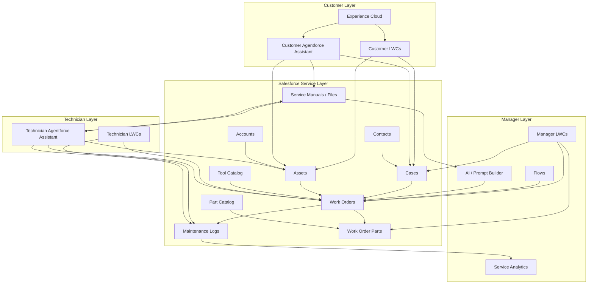
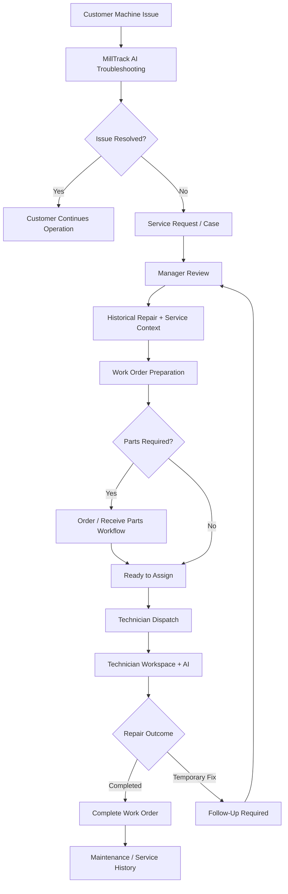

<p align="center">
  
</p>

# MillTrack Intelligence

**MillTrack Intelligence** is a custom Salesforce service-management application designed for equipment service organizations. It connects **customers, service managers, and field technicians** through a shared service workflow while using **Agentforce** to provide AI-assisted troubleshooting, service recommendations, work-order context, and technician guidance.

The application was built around a practical service problem: customers, managers, and technicians often work from different information, causing repeated troubleshooting, incomplete handoffs, unnecessary site visits, and lost time. MillTrack centralizes that process inside Salesforce so each user sees the information and actions relevant to their role.

> **Current status:** MillTrack Intelligence is currently being used by one customer in a production environment. Customer-identifying information and production data are intentionally excluded from this repository.

---

## Table of Contents

- [About the Project](#about-the-project)
- [Technology Stack](#technology-stack)
- [User Roles](#user-roles)
- [Customer Experience](#customer-experience)
- [Manager Experience](#manager-experience)
- [Technician Experience](#technician-experience)
- [Agentforce and AI](#agentforce-and-ai)
- [Application Architecture](#application-architecture)
- [End-to-End Service Workflow](#end-to-end-service-workflow)
- [Core Data Model](#core-data-model)
- [Key Components](#key-components)
- [Service Analytics](#service-analytics)
- [Security and Access](#security-and-access)
- [Project Structure](#project-structure)
- [Roadmap](#roadmap)
- [Production and Privacy](#production-and-privacy)

---

## About the Project

MillTrack Intelligence was designed and developed as a custom Salesforce service-management application focused on real equipment-service workflows.

It combines:

- Salesforce application architecture
- Apex development
- Lightning Web Components
- Experience Cloud
- Workflow automation
- Agentforce
- Prompt Builder
- Salesforce security
- Service analytics
- AI-assisted support workflows

The application is built around a practical service problem: customers, managers, and technicians often work from different information, causing repeated troubleshooting, incomplete handoffs, unnecessary site visits, and lost time. MillTrack centralizes that process inside Salesforce so each user sees the information and actions relevant to their role.

MillTrack manages the full lifecycle of a service issue:

1. A **customer** identifies a problem with a registered machine.
2. The customer can use **MillTrack AI** for initial troubleshooting.
3. If the issue requires service, a **service request / Case** is created.
4. A **manager** reviews the issue, service history, AI-generated context, and historical repair precedent.
5. The manager prepares the **Work Order**, determines required tools or parts, and schedules a technician.
6. The **technician** receives a work-order-specific workspace with repair context, machine information, recommended tools, parts information, service history, and AI assistance.
7. The technician completes the repair or records a temporary fix / follow-up requirement.
8. The completed service visit becomes part of the machine's **maintenance history**, creating better context for future repairs.

The overall goal is to reduce information loss between each stage of service and make previous service knowledge available when it is needed.


---

## Technology Stack

| Area | Technology |
|---|---|
| Platform | Salesforce |
| Backend | Apex |
| Frontend | Lightning Web Components (LWC) |
| Customer Portal | Experience Cloud |
| Automation | Salesforce Flow |
| AI | Agentforce |
| Prompt Orchestration | Prompt Builder |
| Data Access | SOQL |
| Security | Profiles, Permission Sets, Salesforce Sharing & Field Security |
| Files / Knowledge | Salesforce Files and service-manual content |
| Reporting | Salesforce Reports, Dashboards, and custom LWC analytics |
| Development | Salesforce CLI, Git, JavaScript, HTML, CSS / SLDS |

---

## User Roles

MillTrack is built around three primary user experiences.

### 1. Customer

Customers interact with MillTrack through an Experience Cloud portal.

They can:

- View machines registered to their account
- Review machine details and service history
- Start an AI-assisted troubleshooting session
- Report a new service issue
- Track open service requests
- Track active Work Orders
- View repair and maintenance information relevant to their equipment
- Access machine documentation where available

### 2. Manager

Managers coordinate the service operation from the internal Salesforce application.

They can:

- Review incoming service Cases
- Inspect customer, account, and machine context
- Review historical repairs for the same machine or model
- Review AI-generated service context and recommendations
- Convert service issues into Work Orders
- Determine tools and parts requirements
- Track parts that need to be ordered or received
- Dispatch technicians
- Schedule service visits
- Monitor work across each workflow stage
- Review temporary repairs and follow-up requirements
- Analyze service activity by machine model

### 3. Technician

Technicians receive a focused workspace designed around the job they are performing.

They can:

- View assigned and upcoming Work Orders
- Start work on a scheduled service visit
- Review the reported issue and manager guidance
- See recommended tools
- Review parts information
- View machine and customer context
- Review prior service history
- Ask the Technician AI questions about the current Work Order
- Request additional parts
- Record a temporary fix and required follow-up
- Record root cause and repair details
- Complete the Work Order

---

## Customer Experience

<p align="center">
  
</p>

The customer portal is built in **Experience Cloud** and provides a simplified view of the customer's machines and service activity.

### Customer features

- **My Machines** — view registered Assets and machine details
- **Service Requests** — track open service Cases
- **Work Orders** — track active service work
- **Report an Issue** — guided LWC workflow for creating a new service request
- **Machine Service History** — review previous maintenance and completed repairs
- **MillTrack AI** — Agentforce-powered conversational support for initial troubleshooting

The AI experience is designed to collect useful troubleshooting context before a manager or technician becomes involved, improving the information passed into the service workflow.

---

## Manager Experience

<p align="center">
  
</p>

The **Manager Operations Center** provides a service-control view rather than requiring managers to navigate individual Salesforce objects to understand current work.

Work is grouped into operational stages such as:

- Requires Review
- Follow-Up Required
- Parts to Order
- Waiting on Parts
- Ready to Assign
- Assigned Visits
- Active Repairs

This gives managers an immediate view of where service work is accumulating and what action is required next.

### Manager workflow capabilities

- Review incoming Cases
- Generate and review Work Order proposals
- Compare current issues with historical repairs
- Select recommended tools
- Review parts requirements
- Order / receive parts within the MillTrack workflow
- Schedule technicians
- Review scheduled and completed service activity
- Manage temporary fixes and follow-up work
- Review service analytics

---

## Technician Experience

<p align="center">
  
</p>

The technician workspace is designed around one question:

> **What does the technician need to know to complete this job successfully?**

Instead of presenting a generic Salesforce record page, MillTrack provides a Work Order-specific interface containing the most relevant service information.

### Technician Copilot

The Technician Copilot surfaces structured context including:

- Customer-reported issue
- Recommended repair direction
- Recommended tools
- Machine details
- Serial number
- Service history
- Ordered parts
- Supporting customer and account context

### Technician AI

The **Technician AI** is an Agentforce-powered assistant scoped to the current Work Order.

Technicians can ask questions such as:

- Give me a briefing on this Work Order
- What tools do I need?
- Check ordered parts
- Review this machine's history
- Explain the recommended repair
- Help me find relevant service-manual information

The objective is to reduce time spent searching through records and documentation while keeping the technician grounded in the current service context.

---

## Agentforce and AI

AI is not implemented as a standalone chatbot. It is integrated at different points in the service lifecycle.

### Customer AI

Supports initial troubleshooting and issue collection before a service request is escalated.

### Manager AI

Provides service context that can support Work Order preparation, including issue summaries, recommended actions, and relevant historical service information.

### Technician AI

Provides Work Order-grounded assistance during service execution.

### Grounding strategy

Agentforce responses can be grounded using Salesforce data and available service documentation, including:

- Cases
- Work Orders
- Assets
- Maintenance Logs
- Parts information
- Customer / Account context
- Service manuals and Salesforce Files / Knowledge content

This allows the AI to answer within the context of the actual machine and service event rather than functioning as a generic support chatbot.

---

## Application Architecture



MillTrack uses standard Salesforce objects where appropriate and custom service data where additional workflow context is required.

---

## End-to-End Service Workflow



The workflow is intentionally role-based. Customers do not need to understand internal dispatch operations, managers do not need to perform technician repair steps, and technicians receive the service context required to complete the job without searching through unrelated records.

---

## Core Data Model

| Object / Data Area | Purpose |
|---|---|
| Account | Customer organization |
| Contact | Customer users and service contacts |
| Asset | Registered machine / equipment |
| Case | Customer-reported service issue |
| Work Order | Manager-approved service work |
| Maintenance Log | Completed service and repair history |
| Work Order Parts | Parts associated with a repair |
| Part Catalog | Available service parts |
| Tool Catalog | Tools recommended for technician visits |
| Service Manuals / Files | Equipment documentation used by users and AI |

A major design goal is preserving service knowledge after a repair is completed. Historical Maintenance Logs can then provide useful precedent during future service events.

---

## Key Components

MillTrack contains custom Lightning Web Components across each user experience.

### Customer

- `customerPortalHome`
- `customerReportAnIssue`
- `customerAssetDetails`
- `customerAssetServiceHistory`
- `customerServiceRequestList`
- `customerServiceRequestDetails`
- `customerWorkOrderDetails`
- `customerWorkOrderProgress`

### Manager

- `managerOperationsCenter`
- `managerHomeWorkspace`
- `managerReviewWorkOrderWizard`
- `managerDispatchTechnicianWizard`
- `managerOrderPartsWizard`
- `managerReceivePartsWizard`
- `managerFollowUpWorkOrderWizard`
- `managerServiceCalendar`
- `managerWorkOrderSummary`

### Technician

- `technicianHomeDashboard`
- `technicianStartWork`
- `technicianCopilot`
- `technicianAIChat`
- `technicianWorkOrderDetails`
- `technicianRequestPartsWizard`
- `technicianTemporaryFixWizard`
- `technicianCompleteWorkOrderWizard`

The UI is intentionally customized beyond standard record pages so that each role receives a workflow-oriented experience rather than a generic Salesforce interface.

---

## Administrative Workspace

<p align="center">
  
</p>

The broader MillTrack application includes access to service-management data such as:

- Accounts
- Contacts
- Assets
- Cases
- Work Orders
- Maintenance Logs
- Work Order Parts
- Part Catalogs
- Service Manuals
- Reports
- Dashboards

This supports administration and deeper record-level investigation when required.

---

## Service Analytics

<p align="center">
  
</p>

MillTrack includes a custom **Machine Service Intelligence** view that helps managers identify equipment generating the most service effort.

Metrics include:

- Service visits
- Unique service issues
- Technician labor hours
- Follow-up visits
- Resolved visits
- Service activity by machine model
- Configurable reporting periods

This allows service teams to move beyond individual Work Orders and identify recurring service patterns across the installed equipment base.

---

## Security and Access

MillTrack separates access according to the user's role.

### Customer

Experience Cloud users are limited to the customer-facing experience and records relevant to their account.

### Manager

Managers have access to service coordination, Work Order management, scheduling, parts workflows, reporting, and operational service data.

### Technician

Technicians receive access to the records and actions required to perform assigned service work.

The application uses Salesforce security capabilities including:

- Profiles
- Permission Sets
- Object and field-level access
- Sharing and record visibility
- Experience Cloud access controls

---

## Project Structure

A Salesforce DX repository for MillTrack is organized around standard Salesforce metadata and custom application code.

```text
force-app/
└── main/
    └── default/
        ├── classes/              # Apex controllers, services, and tests
        ├── lwc/                  # Customer, manager, technician, and shared LWCs
        ├── flows/                # Workflow automation
        ├── objects/              # Custom objects and fields
        ├── permissionsets/       # Application permissions
        ├── experiences/          # Experience Cloud configuration
        ├── flexipages/           # Lightning record/app pages
        └── staticresources/      # Supporting static application assets

scripts/
└── apex/                         # Development and demo-data utilities
```

Exact contents may evolve as the application continues to develop.

---

## Roadmap

Planned and exploratory improvements include:

### Supplier Ordering Integration

Integrate directly with suppliers that expose APIs so managers can:

- Submit parts orders from Salesforce
- Receive supplier order numbers
- Store order confirmation details
- Track shipment status
- Keep the parts workflow inside MillTrack

### AI Manual Images and Diagrams

Expand AI-assisted service guidance so relevant manual diagrams or images can be surfaced alongside written instructions, with references to the appropriate manual pages.

### Expanded Knowledge Coverage

Increase the number of supported machine models and available service manuals.

### Service Intelligence

Continue expanding analytics around:

- Repeat failures
- First-visit repair success
- High-maintenance equipment
- Parts usage
- Technician labor
- Recurring root causes

### Predictive Service Opportunities

Use accumulated maintenance history to identify patterns that may support preventative or predictive maintenance workflows.

---

## Production and Privacy

MillTrack Intelligence is currently being used by **one customer in a production environment**.

Customer identity, customer production records, credentials, authentication tokens, API secrets, and other sensitive configuration are not intentionally included in this repository.

Screenshots and demonstration records shown in this README use demonstration or anonymized data where appropriate.

> **Security note:** Always review Salesforce metadata and source files for credentials, tokens, org-specific secrets, or customer data before publishing changes to a public repository.


---

**Built with Salesforce, Apex, Lightning Web Components, Experience Cloud, Flow, Agentforce, and Prompt Builder.**
